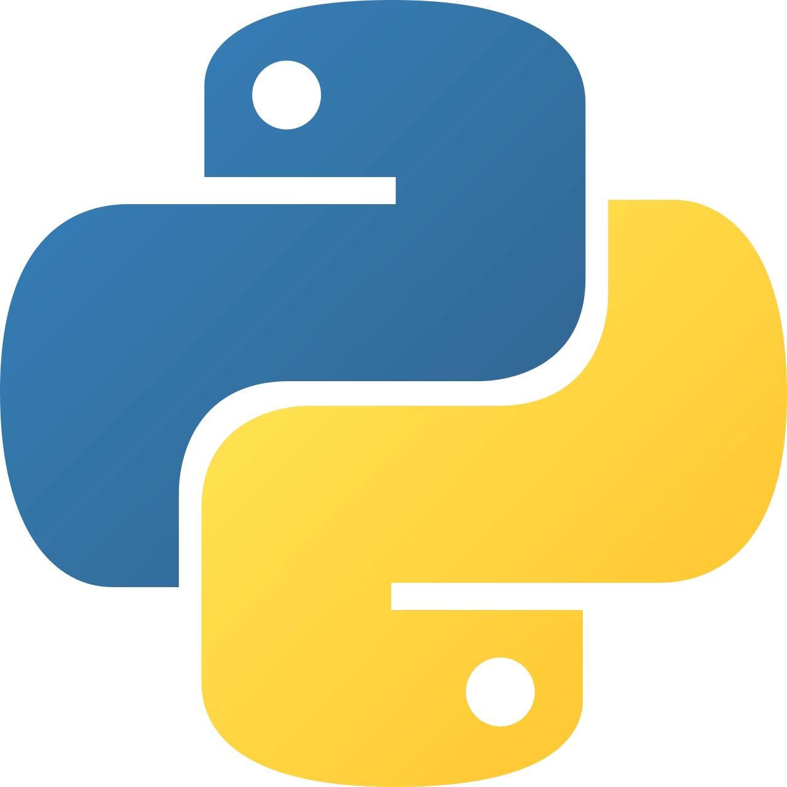

## Introduction

Website ini berisi insight terkait pemrograman untuk analisis data geospasial dan penginderaan jauh. Materinya dimulai dari dasar Python dan JavaScript, dilanjutkan dengan Google Earth Engine (GEE), lalu penerapan *shallow learning* dan *deep learning* pada data spasial. Setiap bab dilengkapi contoh kode dan latihan yang bisa dipelajari secara mandiri.

---

## Tools yang Digunakan

::::{grid} 2 2 4 4

:::{card}
:link: https://www.python.org/

+++
**Python**
:::

:::{card}
:link: https://earthengine.google.com/

+++
**GEE**
:::

:::{card}
:link: https://scikit-learn.org

+++
**Scikit-Learn**
:::

:::{card}
:link: https://pytorch.org/

+++
**PyTorch**
:::

::::

---